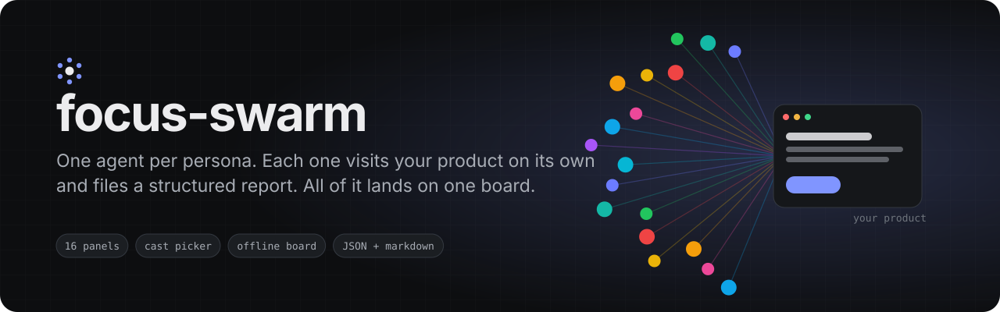
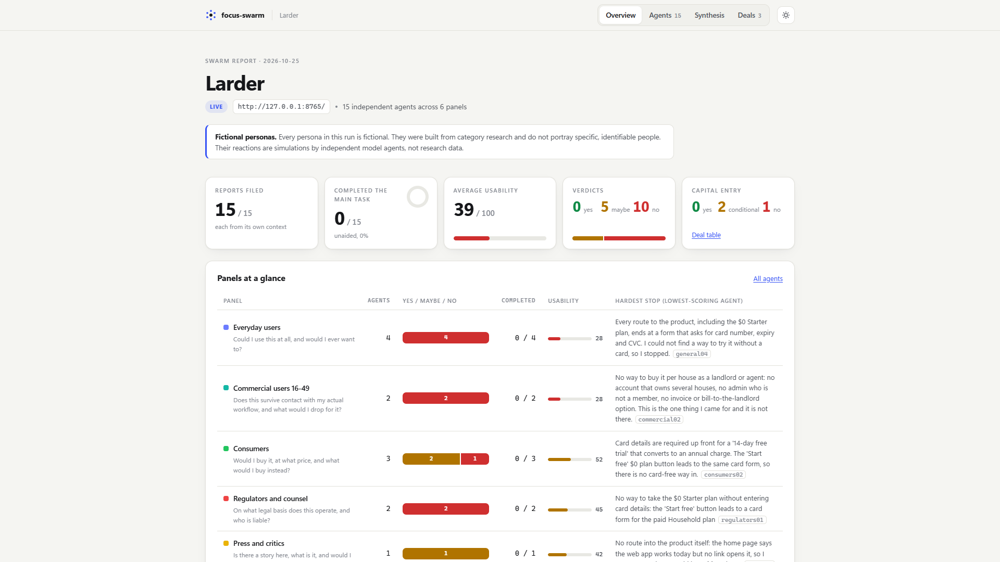
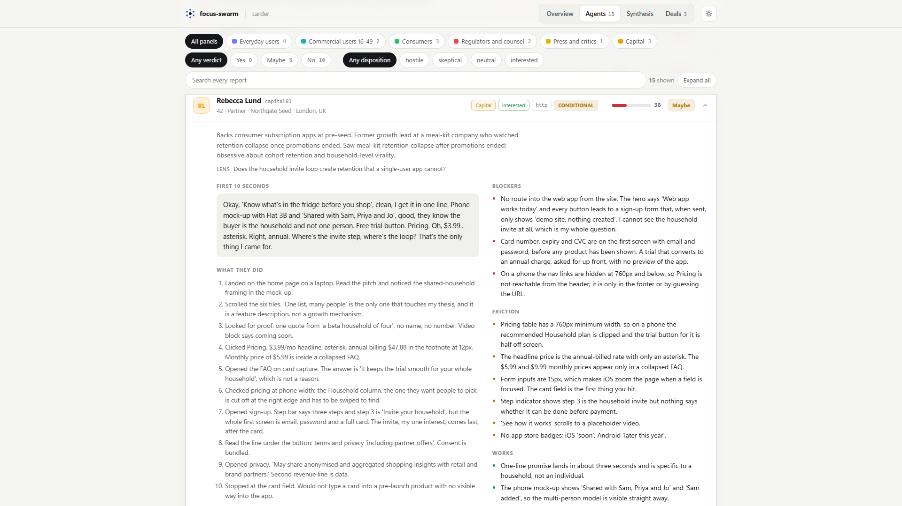
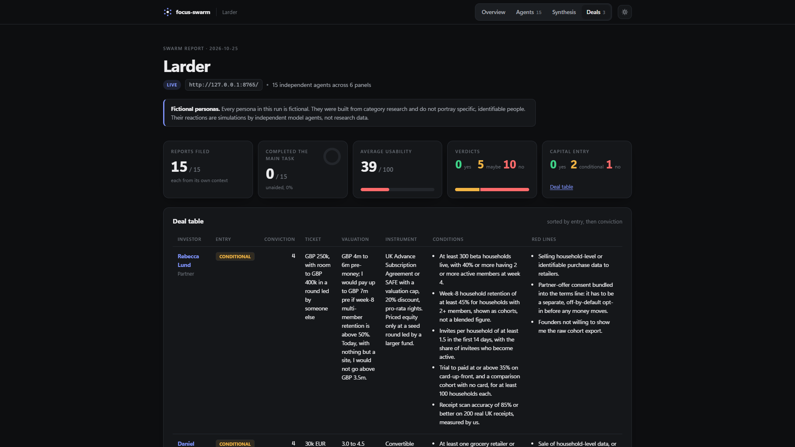
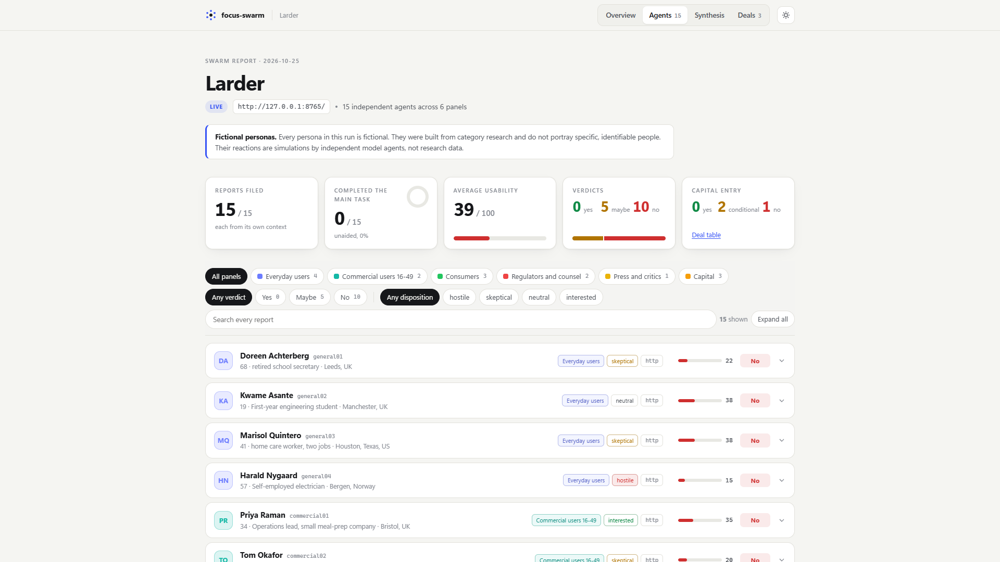
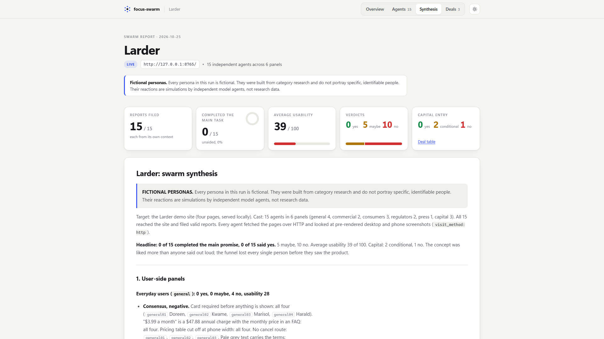
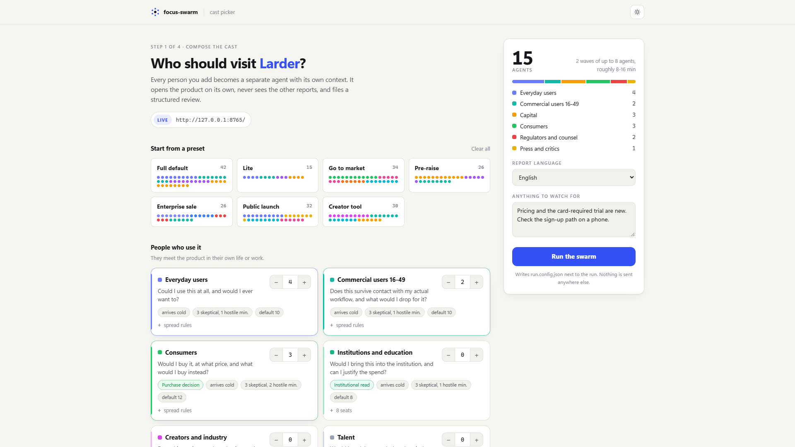
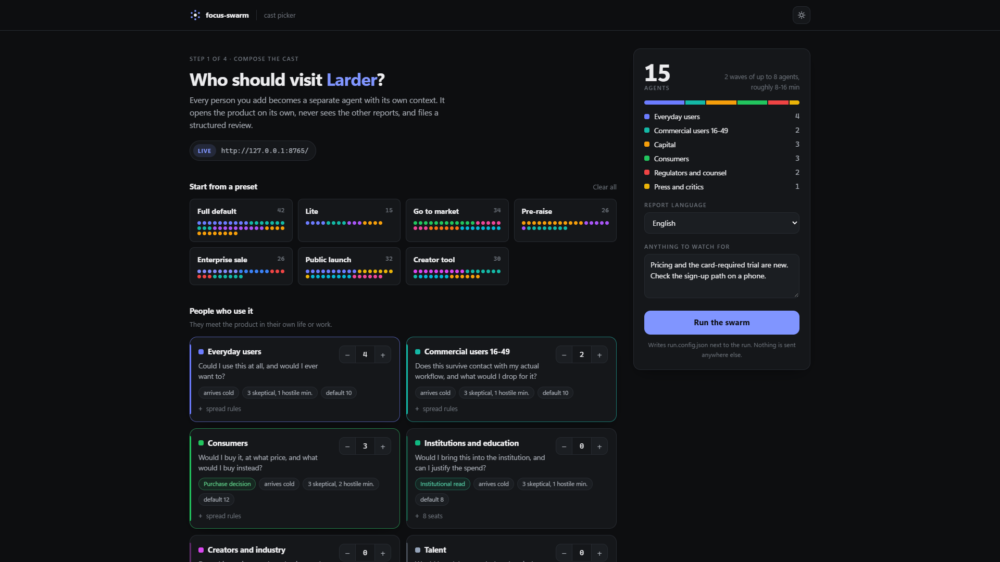
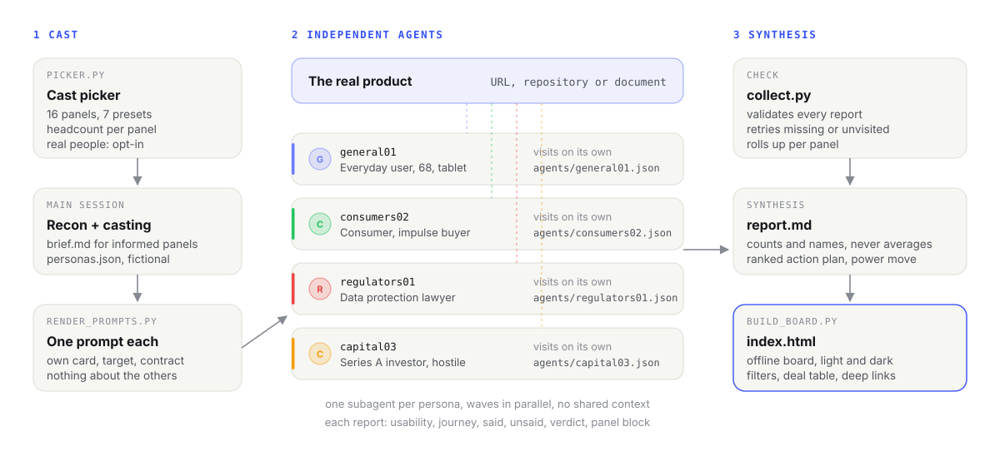

<p align="center">
  
</p>

<p align="center">
  <a href="LICENSE"></a>
  <a href="https://github.com/GameOwerMedia/focus-swarm/actions/workflows/ci.yml"></a>
  
  
  
</p>

**focus-swarm** is a Claude Code skill that sends a swarm of independent persona
agents at your real product. You pick the cast in a local page. Then every
persona runs as its own subagent: it visits the live URL, repository or
document on its own, never sees the other agents, and files a structured JSON
report. Claude reads them all and writes one synthesis, and a script turns the
lot into an offline HTML board.

One model voicing twenty personas in a row drifts toward one opinion. Twenty
separate agents do not: they hit different walls, contradict each other and
leave you with real disagreements to resolve.

> Want a fast, single-context focus group on an idea instead of a build? See
> **[focus](https://github.com/GameOwerMedia/focus)** (worldwide, English) or
> **[focusPL](https://github.com/GameOwerMedia/focusPL)** (Polish market, in Polish).

## Demo

The repo ships a small fictional product, *Larder* (a shared-pantry app with a
few deliberate problems), and a complete recorded run against it: 15 agents in
6 panels, all reports, the synthesis and the board.

**[Open the board](examples/demo-run/index.html)** (download the repo and open
the file; it works offline) or read the
**[synthesis](examples/demo-run/report.md)**.

<p align="center">
  
</p>

What the run found, in short:

```markdown
**Headline: 0 of 15 completed the main promise, 0 of 15 said yes.** 5 maybe,
10 no. Average usability 39 of 100. Capital: 2 conditional, 1 no. The concept
was liked more than anyone said out loud; the funnel lost every single person
before they saw the product.

| Blocker | Hit by | Panels | Stopped or cost | Where in the flow |
|---|---|---|---|---|
| Card required before seeing the product, including the $0 Starter button | 15 of 15 | all | stopped | first click on any CTA |
| Headline price is annual-billed; monthly price hidden in a closed FAQ | 15 of 15 | all | cost (stopped general01, general03) | pricing page |
| Pricing table 760 px wide on a 390 px phone; Household cut off, no scroll cue | 13 of 15 | ... | ... | pricing page on phone |

### Power move
**Make "your pantry is never sold" the product promise, and launch without
partner offers.** It turns the one paragraph that unites hostile regulators, a
press angle and three investors' red lines into the brand's differentiator [...]
```

<table>
  <tr>
    <td width="50%"></td>
    <td width="50%"></td>
  </tr>
  <tr>
    <td>Every agent's report, filterable by panel, verdict and disposition.</td>
    <td>The deal table, when capital is in the cast. Light and dark themes.</td>
  </tr>
  <tr>
    <td width="50%"></td>
    <td width="50%"></td>
  </tr>
  <tr>
    <td>Filters and full-text search across every report.</td>
    <td>The synthesis, with every agent id linked to its card.</td>
  </tr>
</table>

## Why

- **Independent contexts.** Each persona is a separate subagent with only its
  own card. Nobody sees the brief unless a real person in that role would
  arrive informed (researchers, investors, press). User-side agents arrive cold.
- **A real product, not a description.** No target, no swarm. Agents record how
  they visited (`browser`, `http`, `repo`, `document`) and the synthesis says
  when a visit was partial.
- **You pick the cast.** 16 panels, from everyday users and consumers to
  regulators, enterprise IT, press and capital, with headcounts you set. Each
  panel brings its own question and its own report block: deal terms for
  investors, legal exposure for regulators, price thresholds for consumers.
- **Disagreement is enforced.** Casting rules set minimum numbers of hostile
  and skeptical personas per panel, and the synthesis keeps real splits instead
  of averaging them away.
- **Inspectable.** Every prompt, every raw report and the roll-up are plain
  files next to the board. Nothing is hidden in a service.

## Install

**As a plugin** (Claude Code 2.x):

```text
/plugin marketplace add GameOwerMedia/focus-swarm
/plugin install focus-swarm@focus-swarm
```

**By hand:** copy `skills/focus-swarm` into `~/.claude/skills/` (all projects)
or `.claude/skills/` in one project.

```bash
git clone https://github.com/GameOwerMedia/focus-swarm
cp -r focus-swarm/skills/focus-swarm ~/.claude/skills/
```

Requirements: Python 3.9 or newer (standard library only; `python3` on macOS
and Linux) and a Claude Code session that can start subagents with the Agent
tool. The skill calls its scripts by full path from the skill folder, so it
works from any project directory. For live sites, agents use whatever the
session offers: a browser MCP server or extension if present, otherwise web
fetches.

## Quick start

```text
/focus-swarm https://staging.example.com
```

1. Claude starts the cast picker and gives you a local link. Pick panels and
   headcounts (or a preset) and press **Run the swarm**.
2. Claude writes a short recon brief, casts fictional personas to your panels
   and renders one prompt per persona.
3. Agents run in waves of up to 8. Each one visits the target and files
   `agents/<id>.json`; a validator flags anyone who needs a retry.
4. Claude writes `report.md` and builds `index.html`.

Shortcuts:

```text
/focus-swarm ./my-repo lite             15 agents, no picker
/focus-swarm deck.pdf raise             a preset by id (see picker.py --list)
/focus-swarm <url> "consumers and marketing, 6 each"
```

Everything lands in `./focus-swarm-runs/<product>-<date>/` in your project.

<table>
  <tr>
    <td width="50%"></td>
    <td width="50%"></td>
  </tr>
</table>

## How it works

<picture>
  <source media="(prefers-color-scheme: dark)" srcset="assets/how-it-works-dark.svg">
  
</picture>

| Phase | Who | Output |
|---|---|---|
| 0. Target | main session | a run folder; stops if there is no real target |
| 1. Cast picker | you | `run.config.json` |
| 2. Recon | main session | `brief.md` |
| 3. Casting | main session | `personas.json` (fictional by default) |
| 4. Swarm | one subagent per persona | `prompts/<id>.md`, `agents/<id>.json`, `summary.json` |
| 5. Synthesis | main session | `report.md` |
| 6. Board | script | `index.html`, `README.md` |

The scripts do the mechanical parts, so the model spends its tokens on
judgement:

| Script | Does | Useful flags |
|---|---|---|
| `picker.py` | serves the cast picker, writes `run.config.json` | `--port` (default 8137, `0` for a free one), `--open`, `--preset`, `--panels general=4,capital=3`, `--write` (no page), `--static` (offline `picker.html`), `--real-people`, `--list` |
| `render_prompts.py` | one isolated prompt per persona from `references/agent-brief.md` | `--wave-size 8`, `--retry id1,id2`, `--only`, `--tools-note-file` (extra visiting instructions for every agent) |
| `collect.py` | validates reports, rolls up per panel, lists retries | exits `2` when retries are needed |
| `build_board.py` | the self-contained HTML board | `--title`; deep links `#agents`, `#synthesis`, `#deals`, `#agent-<id>`; `?theme=dark` |

## Configuration

- **Panels** live in `skills/focus-swarm/references/panels.json`: label, the
  panel's question, seats, spread rules, disposition floors, whether it may
  read the brief, and its extra report block. Add a panel by adding an entry;
  the picker, prompts, validator and board pick it up.
- **Presets** are named casts in the same file (`lite` is 15 agents).
- **The agent prompt** is one template, `references/agent-brief.md`.
- **The synthesis structure** is in `references/synthesis.md`.
- **Report language** is set in the picker (`lang`); personas still speak in
  their own register.

## Real people (opt-in)

By default **every persona is fictional**: built from category research,
placed at invented organisations, never portraying an identifiable person.

The research, capital and press panels can optionally be profiled from public
sources about real, named professionals, for example to rehearse a pitch to a
specific kind of fund. This is off unless you switch it on in the picker, and
then the skill:

- uses public professional sources only, at least two links per person;
- puts verbatim quotes only in a separate `public_record` field and labels
  everything the persona "says" as a simulation;
- drops anyone without a solid public record;
- marks the whole package as internal on every page.

Do not publish a run made this way. The example in this repo uses fictional
personas only.

Profiles and the optional outreach list are personal data about named people:
data-protection law (for example the GDPR) and the terms of the sites you
draw on apply to you, so keep that output private and delete it when you are done.

## FAQ

**Is this user research?** No. It is a simulation that surfaces objections,
broken paths and conflicts quickly. Treat every finding as a hypothesis to
check with real people.

**How long and how much?** The demo (15 agents, a four-page site) took about
ten minutes of wall time in two waves. Cost scales with the number of agents
and how much each one reads; persona agents run well on a mid-size model, keep
the synthesis on the strongest one.

**Do agents need a browser?** No. With a browser tool they click through like
users; without one they fetch pages over HTTP. The demo run used HTTP fetches
plus pre-rendered screenshots and records that in every report.

**Can it review a repository or a PDF?** Yes: `repo` agents read and run the
code, `document` agents read the file.

**Why Python scripts?** Validation, retries and the board are deterministic
work. Doing them in code keeps the run reproducible and cheaper.

## Limitations

- Agents are only as good as their access. Login walls, captchas and payment
  steps stop them where they would stop a stranger; give them a staging URL or
  test credentials.
- Many agents sharing one browser fight over tabs. Keep waves small or let them
  fall back to HTTP fetches.
- Personas are model-made. Casting floors and independent contexts reduce
  sameness but do not remove it.
- Market facts (prices, regulations, funds) are as current as the model.
  Verify anything you act on.

## Roadmap

- Optional screenshot capture per agent, embedded in the board.
- Run-to-run comparison on the board (before and after a fix).
- More panel blocks (accessibility audit, localisation).

## Repository layout

```text
skills/focus-swarm/SKILL.md          the skill
skills/focus-swarm/references/       panels, casting rules, prompt template, synthesis, schema
skills/focus-swarm/scripts/          picker, prompts, collect, board (Python, stdlib only)
examples/demo-site/                  the fictional Larder site
examples/demo-run/                   a complete recorded run against it
tests/                               unit tests (python -m unittest discover -s tests)
docs/screenshots/                    the images in this README
```

## License

[MIT](LICENSE). Contributions welcome, see [CONTRIBUTING.md](CONTRIBUTING.md).
